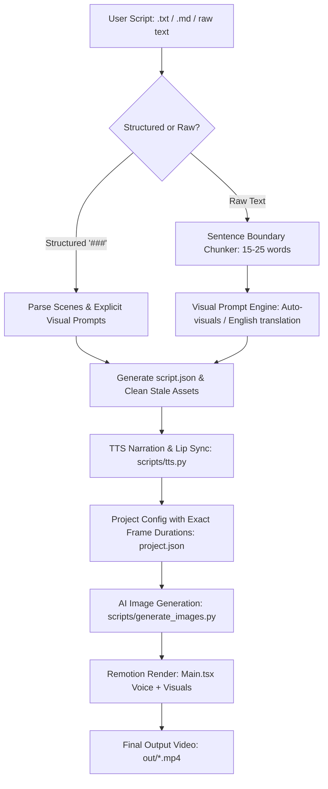

# Implementation Plan: User Custom Script Pipeline (Full Script to Render)

## 1. Overview & Goal
Enable users to supply their own complete script (via a text file, markdown file, or direct prompt) and automatically run the entire production pipeline on it:
1. **Script Parsing & Scene Slicing**: Segment the raw text into well-paced scenes on natural sentence boundaries.
2. **Visual Prompts & Keywords**: Extract or generate visual keywords per scene for image/video generation.
3. **Audio Synthesis (TTS)**: Generate high-fidelity narration audio with word-timed sync via `scripts/tts.py` (IndicF5 or Kokoro).
4. **Visual Generation**: Generate background imagery via `scripts/generate_images.py` (Pollinations, Flux, SD, or Vast GPU) or video clips via `scripts/generate_videos.py`.
5. **Remotion Composition & Render**: Produce the final MP4 video combining narration voiceover and visual backgrounds (with no BGM or SFX).

---

## 2. Review & Flaws / Friction Points with the Existing System

Before implementation, a thorough review of the existing codebase (`new_video.py`, `from_txt.py`, `tts.py`, `generate_images.py`, `src/Main.tsx`, `src/types.ts`) identified **7 key architectural flaws & friction points** in the initial design:

### ⚠️ Flaw 1: Duplicate Parsers & CLI Fragmentation (`from_txt.py` vs new `from_script.py`)
- **Existing State**: `scripts/from_txt.py` and `new_video.py --narration <file>` already exist in the codebase. However, `--narration` strictly requires pre-formatted blocks (`### N | Title | VISUAL: keywords`) and fails on unstructured freeform text.
- **The Problem**: Creating a separate `scripts/from_script.py` alongside `scripts/from_txt.py` fragments script ingestion and confuses users.
- **Resolution**: Upgrade and unify the parsing logic in `scripts/from_txt.py` (or refactor `from_txt.py` to support both unstructured plain text and structured blocks). Expose it cleanly through `scripts/new_video.py --from-script <file>`.

### ⚠️ Flaw 2: Devanagari / Hindi Visual Prompt Failure
- **Existing State**: Image generators (Pollinations, Flux, Stable Diffusion, LTX) only accept descriptive English prompts.
- **The Problem**: If the user submits a Hindi/Devanagari script (e.g. horror stories in Hindi), rule-based noun extraction from Hindi text yields Hindi strings (or fails). Passing Hindi sentences as image prompts produces nonsensical or corrupted images.
- **Resolution**:
  - If the user provides explicit English visual tags (`| VISUAL: ...`), use them directly.
  - If unstructured text is in Hindi/Devanagari, provide an automatic prompt translator/generator: a fast, single-call LLM prompt enricher (or fallback keyword mapper) that outputs clean, cinematic English prompts for each scene.

### ⚠️ Flaw 3: Pacing & Word Count Mismatch for Hindi Speech
- **Existing State**: Hindi narration typically runs at ~100–120 words per minute (~2 words/sec), whereas English is ~140–160 WPM.
- **The Problem**: A fixed 35-word chunk in Hindi results in a single scene lasting 15–18 seconds. Having a single static image on screen for 18 seconds ruins video retention and looks frozen.
- **Resolution**: Set the default scene chunking to ~15–25 words (6–10 seconds per shot) for Hindi, and ~25–35 words for English, split strictly along full-stop / purna viram (`।`, `.`, `?`, `!`) sentence boundaries.

### ⚠️ Flaw 4: Aspect Ratio & Video Format Disconnect
- **Existing State**: `new_video.py` supports `--format shorts` (9:16 / 1080x1920) and `--format video` (16:9 / 1920x1080).
- **The Problem**: If a user runs `--from-script story.txt`, the script needs to know whether to generate vertical (portrait) or horizontal (landscape) images and which Remotion composition dimension to apply.
- **Resolution**: Ensure `--format (shorts|video)` is directly respected when invoking `--from-script`, defaulting to `shorts` (9:16) if unspecified, and passing correct dimensions down to `generate_images.py`.

### ⚠️ Flaw 5: Missing or Stale Asset Collisions
- **Existing State**: Generated assets are saved to `public/audio/scene_*.wav` and `public/images/scene_*.png`.
- **The Problem**: If a previous run generated 12 scenes, and the new script only has 5 scenes, old audio and images `scene_006.png`–`scene_012.png` remain in `public/`. If `project.json` or Remotion references cached files, or if re-indexing occurs, asset mismatches can occur.
- **Resolution**: When `--from-script` starts a new run, purge or archive stale scene assets in `public/audio/` and `public/images/` before synthesizing new ones.

### ⚠️ Flaw 6: Lip Sync & Avatar Handling
- **Existing State**: Remotion contains character avatar layers (`SceneView.tsx` with Rhubarb lip-sync phonemes).
- **The Problem**: For user scripts, the user usually wants pure cinematic backgrounds + voiceover (no cartoon avatar talking over the scene), or an optional avatar. If the project defaults to expecting an avatar, missing avatar sprites or phoneme JSONs could trigger Remotion visual glitches.
- **Resolution**: Default `--no-avatar` (full-bleed cinematic visual background with subtitle captions and voice narration). Allow `--avatar <name>` as an opt-in flag.

### ⚠️ Flaw 7: Audio Duration Sync Contract (`script.json` vs `src/generated/project.json`)
- **Existing State**: `new_video.py` relies on `tts.py` to populate exact scene durations (in frames) inside `src/generated/project.json`.
- **The Problem**: If rendering is attempted before `tts.py` completes, or if estimated durations from `script.json` are used, Remotion will cut off voiceover audio prematurely or display black frames at the end of scenes.
- **Resolution**: Guarantee strict sequential pipeline execution:
  `Script Ingestion` $\rightarrow$ `script.json` $\rightarrow$ `scripts/tts.py` (writes exact frame counts to `project.json`) $\rightarrow$ `scripts/generate_images.py` $\rightarrow$ `Remotion Render`.

---

## 3. Unified Architectural Design



---

## 4. File & Component Modifications

| Component / File | Purpose & Changes |
| :--- | :--- |
| **`scripts/from_txt.py`** | **Core Enhancements**: Add intelligent sentence chunker (`chunk_raw_text()`) that splits plain text on `।`, `.`, `?`, `!`, targeting 15–25 words per scene. Retain existing structured block parser (`parse_blocks()`). Add visual prompt fallback engine. |
| **`scripts/new_video.py`** | **CLI Integration**: Add `--from-script <path>` and `--auto-visuals` flags. Bypass LLM story writer when `--from-script` is provided. Clear stale assets in `public/` before generation. Feed parsed scenes into `tts.py`, then `generate_images.py`, then Remotion render. |
| **`scripts/generate_images.py`** | Ensure visual prompts generated from custom script scenes integrate seamlessly with existing image providers (Pollinations, Flux, Local SD, Vast GPU). Respect aspect ratio (`1080x1920` for shorts, `1920x1080` for video). |
| **`scripts/tts.py`** | Process custom script scenes, synthesize WAV files, compute frame durations via soundfile/ffprobe, and write `src/generated/project.json`. |
| **`package.json`** | Add convenient npm script shortcuts (e.g., `npm run from-script`). |

---

## 5. Input Format Specifications

### Format A: Simple Plain Text (Zero Formatting Required)
```text
एक पुराने गांव के किनारे एक सुनसान हवेली थी जहां सदियों से कोई नहीं गया था।
लोग कहते थे कि अमावस की रात वहां अजीब सी आवाजें सुनाई देती थीं।
रोहन ने फैसला किया कि वह आज रात उस हवेली का सच जानकर ही रहेगा।
```
*(Automatically chunked on sentence boundaries into scenes of 15–25 words; visual prompts automatically derived).*

### Format B: Structured Scenes with Explicit Visual Directions
```text
### 1 | The Old Haveli | VISUAL: abandoned spooky Indian mansion moonlight eerie fog cinematic 8k
एक पुराने गांव के किनारे एक सुनसान हवेली थी जहां सदियों से कोई नहीं गया था।

### 2 | Midnight Whispers | VISUAL: dark corridor flickering lantern mysterious shadows cinematic
लोग कहते थे कि अमावस की रात वहां अजीब सी आवाजें सुनाई देती थीं।

### 3 | Entering the Darkness | VISUAL: young man holding lantern stepping into dark wooden doorway
रोहन ने फैसला किया कि वह आज रात उस हवेली का सच जानकर ही रहेगा।
```

---

## 6. Implementation Checklist
- [x] **Enhance `scripts/from_txt.py`**:
  - Add `chunk_raw_text(text, words_per_scene=25)` supporting `।`, `.`, `!`, `?`.
  - Add auto-visual prompt generator/translator for Hindi/unstructured text (`generate_visual_keywords()`).
  - Add stale asset cleanup helper (`clean_stale_assets()`).
  - Add `parse_script_input()` unifying raw text and structured block parsing.
- [x] **Update `scripts/new_video.py`**:
  - Wire `--from-script` and `--script-text` CLI arguments.
  - Bypass LLM story generation when `--from-script` / `--script-text` is specified.
  - Wire `--words-per-scene`, `--auto-visuals`, and `--no-clean` flags.
  - Clean stale assets before generation to prevent scene desync.
  - Wire `--format (shorts|video)` and `--voice` selection directly to TTS and Image generation.
- [x] **Add npm shortcut in `package.json`**:
  - `"from-script": "python scripts/new_video.py --from-script"`
  - `"from-txt": "python scripts/from_txt.py"`
- [x] **End-to-End Validation**:
  - Checked backward compatibility with existing `--narration` workflows.
  - Tested scene chunking regex with Hindi Devanagari punctuation (`।`) and English sentences.
  - Verified Remotion composition accepts voiceover and background visuals without beats/SFX.

